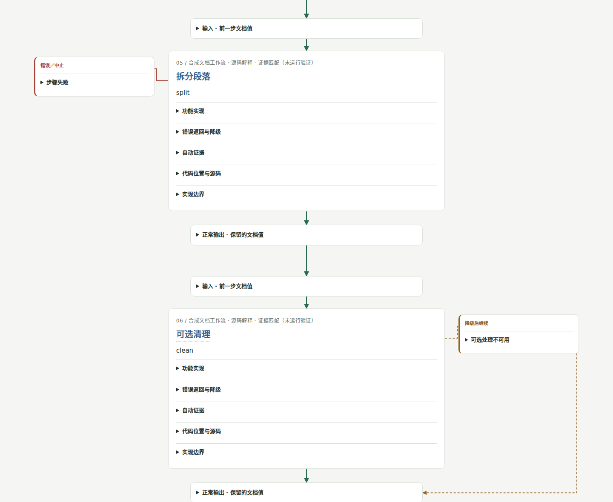

# Code Review Kit

English · [简体中文](README.md)

Turn source evidence and business explanations into collapsible, traceable HTML maps. No model API calls by default; caches, bounded evidence packets and a fixed template reduce repeated work.



- Small boxes show inputs and normal outputs; large boxes show function, implementation, state and source links.
- A straight green spine shows success order; red side branches show errors/stops; gold dashed lines show fallbacks returning to a specified node.
- A business node can reference multiple functions and source context in other languages. It does not have to correspond to one function.
- Expand implementation to follow code blocks in order: actor, input, condition, result and next destination. Cross-file calls explain handoffs and return points; step links target the relevant code blocks. Structural checks prevent out-of-range references; whether the narrative is sufficient still requires AI source review.
- Automatic extraction supports Rust, Python and Dart, including mixed-language business cards. Unknown dynamic dispatch, unexpanded macros and dependencies outside the graph remain explicit limitations, not claims of complete program analysis or runtime proof.

## Installation

Python 3.11+; Windows, macOS and Linux. Native parser dependencies install for the execution environment and are not bundled in the Skill.

File selection uses pinned pure-Python pathspec. With or without rg, the same repository-local ignore rules apply and generated/private-state directories are excluded; parent/global configuration outside the repository is not inherited. See [architecture](docs/architecture.md) for the policy.

```sh
git clone https://github.com/vcorange-chan/code-review-kit.git
cd code-review-kit
python -m pip install .
code-review doctor
```

For a standalone installation, run `install.ps1` on Windows, or `python skills/code-review-kit/scripts/setup.py` on any platform, then use `python review.py`. Dependencies and indexes can live in a writable temporary state directory outside the installation, supporting read-only Skill mounts; set `CODE_REVIEW_KIT_STATE` to choose persistent storage. `rg` speeds up file enumeration; Python traversal is used when it is unavailable.

Pi:

```sh
pi install git:github.com/vcorange-chan/code-review-kit@v0.8.0
```

Use `/skill:code-review-kit`. For Cowork, download `code-review-kit-skill.zip` from GitHub Releases and upload it under Customize → Skills; code execution must be enabled. The uploaded package is self-contained and installs dependencies in its actual execution environment on first extraction. It does not assume access to the host machine's drive paths. See [installation notes](skills/code-review-kit/references/install.md).

## Select a function

Default `--language auto` analyzes Rust, Python and Dart by suffix; an explicit language narrows indexing. Python does not import target modules, Dart needs no Flutter/Dart SDK, and neither executes target code. Accepted Python syntax depends on the interpreter running the Kit. See [source languages](docs/languages.md) for coverage and limitations.

```sh
code-review function --repo /path/to/repository --symbol some_function --file src/lib.rs --out ./review
code-review function --repo /path/to/repository --language python --symbol run --file service.py --out ./review-python
code-review function --repo /path/to/repository --language dart --symbol Worker.run --file lib/worker.dart --out ./review-dart
```

Open `review/index.html`. Ambiguous names require a file or a fully qualified symbol. By default, traversal follows two downstream levels and at most 16 nodes; adjust `--depth` and `--max-nodes` as needed.

## Select a business workflow

A person or AI identifies the nodes once and saves a business manifest for subsequent reuse:

```sh
code-review business --manifest examples/document-pipeline/business.json --explanations examples/document-pipeline/explanations.json --out ./review --depth 0 --max-nodes 64
```

The public example is a portable, synthetic document workflow: 14 stages with five fallback returns. It is not a source snapshot from a private project. Override the manifest's repository with `--repo` for another machine or a directory mounted in Cowork.

Nodes reference multiple `sources`. For Rust/Python/Dart, prefer `{"file":"src/lib.rs","symbol":"accept"}` so the index supplies current lines. `success` edges connect the straight spine; `resume` edges specify which node's input/output receives a fallback return. See [the flow format](skills/code-review-kit/references/flow-format.md). Basic cards can be generated without explanations, with unknown meaning clearly marked.

Legacy line-based manifests can be migrated explicitly; old explanations are not automatically rebound:

```sh
code-review pin-sources --manifest old-flow.json --repo /path/to/repository --out pinned-flow.json
```

The mixed example connects Dart input, Python conversion and a Rust size gate, including fallback recovery. Cross-language handoffs are manifest declarations; this fixture implements no actual FFI/RPC bridge.

```sh
code-review business --manifest examples/document-pipeline/mixed-business.json --language auto --explanations examples/document-pipeline/mixed-explanations.zh.json --out out/mixed --depth 0
code-review business --manifest examples/document-pipeline/mixed-business.json --language auto --explanations examples/document-pipeline/mixed-explanations.en.json --output-language en --out out/mixed-en --depth 0
```

## AI supplies explanations, not page code

| Output | Purpose |
| --- | --- |
| index.html | Self-contained, offline interactive report |
| facts.json | Extracted facts, source snapshots, call candidates and evidence hashes; usually kept locally |
| evidence-packet.json | Small AI input, at most 24000 UTF-8 bytes by default (not a token count) |
| explanations.seed.json | Explanation skeleton bound to current evidence |
| explanations.json | Separate business explanations; the legacy default file is preserved |
| explanations.zh.json / explanations.en.json | Explanations saved by language to avoid overwriting each other |
| build-stats.json | Brief results including timing, cache reuse and cards requiring review |

```sh
code-review render --facts review/facts.json --explanations review/explanations.json --html review/index.html
code-review packet --facts review/facts.json --symbol some_function --out packet.json --bytes 10000
```

Bound explanations can be reused. Relevant function, source or graph changes mark them for review; inserting code before a symbol anchor does not change its identity. An unrelated type's derive no longer invalidates every explanation in the file; relevant types, function attributes and visible imports remain conservatively tracked. Never rebind old explanations to a new hash merely to dismiss a warning. The CLI and every AI entry share the same core and template.

## Chinese and English output

Language precedence is: explicit user choice > user prompt language > existing explanation/facts language; with none of these, Chinese remains the fallback. The Skill interprets the user's language instruction and passes it to the shared CLI. The standalone CLI can use `--prompt` to detect common language requests and Chinese/English text. Specify a language explicitly for mixed text or complex instructions. `--prompt` selects output language only: it does not replace function/workflow arguments, and the original prompt is not saved.

```sh
code-review function --repo /path/to/repository --symbol run --out review --output-language en
code-review function --repo /path/to/repository --symbol run --out review --output-language zh
code-review function --repo /path/to/repository --symbol run --out review --prompt "Review run"
code-review function --repo /path/to/repository --symbol run --out review --prompt "审阅 run"
```

`--output-language` accepts `auto` (default), `zh`/`中文`, and `en`/`English`. It is independent of the source-analysis option `--language auto|rust|python|dart`. The `function`, `business`, `render` and `packet` commands share these rules. Switching languages rebuilds HTML while reusing the source index and evidence.

UI labels, states, buttons and evidence-packet guidance use the target language. Source code, symbols and paths remain unchanged. The AI calling the tool writes business explanations in that language; the tool does not translate through a network service. Explanation JSON declares `output_language` (legacy files are treated as Chinese). Top-level `title` and `flow.start_label/end_label` can supply localized report and terminal labels. When existing explanations use another language, the report explicitly requests translation, preserves the original file and generates a seed in the target language. AI fills only the missing language version, preserves evidence hashes and runs `render`. Chinese explanations are not presented as English content inside an English UI.

```sh
code-review business --manifest examples/document-pipeline/business.json --explanations examples/document-pipeline/explanations.en.json --output-language en --out review-en --depth 0 --max-nodes 64
code-review render --facts review-en/facts.json --explanations review-en/explanations.en.json --html review-en/index.html --output-language en
```

## Shareable source links

By default, HTML embeds selected source excerpts. References navigate to lines within the report without relying on the generating machine's drives. Copied locations are repository-relative. Source text can still contain sensitive content written into the project; check the actual content before sharing.

Choose other link modes explicitly when needed:

```sh
code-review function --repo /path/to/repository --symbol run --out review --link-mode relative
code-review function --repo /path/to/repository --symbol run --out review --link-template 'https://github.com/OWNER/REPO/blob/REV/{path}#L{line}'
code-review function --repo /path/to/repository --symbol run --out review --link-template 'vscode://file{absolute_path}:{line}'
```

`relative` requires retaining the source directory structure alongside the report; `local` explicitly generates local file links. Templates support `{path}`, `{absolute_path}`, `{line}` and `{end_line}`; absolute_path is a URI path with a leading slash. Default embedded links navigate to actual line targets. Ordinary file links do not promise browser line navigation.

When source, explanations, manifest and template are unchanged, HTML is reused directly instead of sending the complete report back to a model. Otherwise, the syntax index is reused by file hash. Source is read-only; the tool does not execute the target project or create runtime experiments by default.

## Step-by-step rebuild lectures (copy-tutor)

`skills/copy-tutor` walks a learner through rebuilding one business flow. Each step covers:

- what the step must achieve;
- which needs and constraints lead to the design;
- which method implements it;
- why the lecture later returns to an earlier function.

Lecture JSON contains no code. Lines are cut by number from the facts source snapshot; every line of a node is either shown or folded with a stated destination. Each step binds the node digest, so a source change marks the step for review instead of pairing old prose with new code.

Every reason has one of three kinds, and states its support and limits:

- recorded: the author wrote it down;
- inferred: worked back from the final code;
- teaching: an explanation given for clarity.

Questions and notes are appended to a separate JSONL file. Each record is bound to the lecture, step and revision, and can be expanded on the page. Omitting the discussion file renders a public lecture without personal discussion.

```sh
code-review function --repo examples/document-pipeline --language rust --file src/lib.rs --symbol run --depth 1 --max-nodes 32 --out tutor
code-review lecture --lecture examples/document-pipeline/lecture.zh.json --facts tutor/facts.json --html tutor/lecture.html
code-review discuss --lecture my-lecture.json --discussion my-discussion.jsonl --step s1 --kind note --quote "…" --text "…"
```

See the [lecture format](skills/copy-tutor/references/lecture-format.md). Cowork users upload `copy-tutor-skill.zip`, which bundles the same tool.

New lectures separate reading progress, fixed program behavior and counterfactual comparisons instead of presenting revealed lines as a patch history. Use `function/business --source-ref COMMIT` to read a fixed Git commit without committing, staging or switching the working tree. Local facts retain verifiable snapshots of relevant files; full files stay outside default model packets. After `lecture --accept-new` locks the source identity, another snapshot cannot be substituted; legacy lectures retain an unlocked-source notice.

`tutor add` appends one step draft; `tutor retell` atomically archives the complete previous view; `tutor select` computes fold ranges and derives real signatures; `tutor packet` produces bounded, reusable step evidence. `status/next/resume` preserve reading position without claiming mastery. Full selections and discussions are retained, old revisions keep their own bindings, and unmatched records remain readable in full. See [Tutor operations](skills/copy-tutor/references/operations.md).

Event-driven example: extract `events-business.json` and use `events-lecture.zh.json` to follow a late result through the state guard to the view label. Source is `events.py`; all three files are under `examples/document-pipeline`. The example is explained statically and includes neither a real UI nor runtime verification.

## Pre-release privacy checks

Public examples use fictional projects only. Real manifests, source snapshots, explanations and Reviews stay in ignored local directories. Publication checks validate allowed files and their hashes, scan for host paths, configured private terms and Review data, and verify every ZIP/wheel entry. Public demo HTML must be rebuilt from reviewed synthetic inputs and match byte for byte; renaming a private report does not bypass the check.

```sh
python scripts/check_release.py source
git config --local core.hooksPath .githooks
python scripts/prepare_release.py --out dist/release
python scripts/prepare_release.py --out dist/release --verify
```

Publishers configure a JSON array of private terms in ignored `.local/privacy-denylist.json` or the local `REVIEW_KIT_PRIVATE_TERMS` environment variable. Real terms are not sent to CI or written into tracked files. CI uses an empty term baseline and checks generic paths, hashes and packages; local push/publish gates additionally block private names. Publishing requires this configuration. Failures stop the operation and print only a rule and identifier; use `--report .local/privacy-report.json` for local details. Review source and images before updating `.release-policy.json` hashes. Automated checks cannot recognize every privacy implication; old commits and downloaded copies are not retracted. See [release privacy](docs/release-privacy.md).

## Limitations and development

Analysis produces a bounded graph of syntax candidates. Macros, traits/generics, runtime routing and conditional compilation are not fully resolved. Object methods show candidates or unresolved reasons. Direct parameter type annotations are conservative hints, not type checking. References in other unsupported languages are context, not automatic call-analysis support. Hash matches do not prove model explanations correct.

`reviewkit/languages.py` defines the adapter contract; Rust, Python and Dart are registered. Future Zig, C and Go implementations belong in adapters and reuse business views, explanations, links and the template. See [architecture](docs/architecture.md) for module boundaries.

Version 0.3 changed the evidence hashing rules. Older explanations may need one review; the tool does not silently hide that status. The seven external review findings and their verification are recorded in [the follow-up](docs/review-findings.md).

```sh
python -m unittest discover -s tests -v
node --check reviewkit/templates/review.js
python scripts/build_dist.py
python scripts/smoke_skill.py
```

CI tests the tool and actual ZIP installation path on Windows/macOS/Linux with Python 3.11/3.12, and checks Pi package installation. A discoverable, executable Skill does not establish successful execution inside an individual user's Cowork account.

MIT License. Releases exclude local caches, native dependencies, and private project manifests or generated reports. The release demo HTML uses only the public synthetic fixture.
