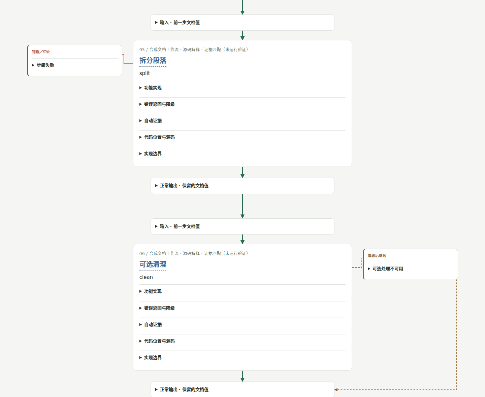

# Code Review Kit

[English](README.en.md) · 简体中文

把源码证据和业务解释生成可折叠、可追溯的 HTML 地图。默认不调用模型 API；以缓存、精简证据包和固定模板减少重复工作。



- 小方框：输入与正常输出；大方框：功能、实现、状态与源码链接。
- 绿色直线主脉：成功顺序；红色侧分支：错误／中止；金色虚线：降级并回到指定节点。
- 一个业务节点可关联多个函数及其他语言的源码上下文，不必把业务节点等同于函数。
- 展开实现后，可按代码块顺序阅读执行者、输入、判断、结果与下一步；跨文件调用写清交接和返回，步骤链接定位到对应代码块。格式检查保证引用不越界，解释是否充分仍需 AI 阅读判断。
- 当前自动提取 Rust、Python、Dart，支持混合语言业务卡片。未知动态分派、未展开宏、图外依赖保留为限制，不冒充完整程序分析或运行证明。

## 安装

Python 3.11+；支持 Windows、macOS、Linux。原生解析依赖按执行环境安装，不随 Skill 打包。

文件选择使用固定版本的纯 Python pathspec。无论有无 rg，都应用同一套仓库内忽略规则，并排除生成目录与本地私有状态；不继承仓库外父级或全局配置。具体规则见 [架构说明](docs/architecture.md)。

```sh
git clone https://github.com/vcorange-chan/code-review-kit.git
cd code-review-kit
python -m pip install .
code-review doctor
```

也可使用独立目录安装：Windows 运行 `install.ps1`，或在任意平台运行 `python skills/code-review-kit/scripts/setup.py`，随后使用 `python review.py`。依赖和索引可保存在安装目录外的可写临时状态目录，支持只读 Skill 挂载；设置 `CODE_REVIEW_KIT_STATE` 可选择持久目录。`rg` 可加速文件枚举，未安装时使用 Python 遍历。

Pi：

```sh
pi install git:github.com/vcorange-chan/code-review-kit@v0.8.0
```

使用 `/skill:code-review-kit`。Cowork：从 GitHub Release 下载 `code-review-kit-skill.zip`，在 Customize → Skills 上传；需要启用代码执行。上传包是自包含的，首次提取时在实际执行环境安装依赖。它不假定可访问宿主机的盘符。详见 [安装说明](skills/code-review-kit/references/install.md)。

## 指定函数

默认 `--language auto` 按后缀分析 Rust、Python、Dart；显式指定可缩小索引。Python 不导入目标模块，Dart 不需要 Flutter/Dart SDK，均不执行目标代码。Python 可解析的语法版本取决于运行 Kit 的 Python。范围与限制见 [语言说明](docs/languages.md)。

```sh
code-review function --repo /path/to/repository --symbol some_function --file src/lib.rs --out ./review
code-review function --repo /path/to/repository --language python --symbol run --file service.py --out ./review-python
code-review function --repo /path/to/repository --language dart --symbol Worker.run --file lib/worker.dart --out ./review-dart
```

打开 `review/index.html`。重名时要求补充文件或完整符号。默认向下追踪 2 层、最多 16 个节点，可调整 `--depth` 和 `--max-nodes`。

## 指定业务

首次由人或 AI 定位节点并保存业务清单，以后复用清单：

```sh
code-review business --manifest examples/document-pipeline/business.json --explanations examples/document-pipeline/explanations.json --out ./review --depth 0 --max-nodes 64
```

公开示例是一个可移植的合成文档流程：14 个阶段，包含 5 个降级返回。它不是来自私有项目的源码快照。清单可使用 `--repo` 覆盖路径，适合另一台机器或 Cowork 挂载目录。

节点关联多个 `sources`；Rust/Python/Dart 来源推荐 `{"file":"src/lib.rs","symbol":"accept"}`，行号会随索引更新。`success` 边连接直线主脉，`resume` 边指定某个降级分支回到哪个节点的 input/output。格式见 [流程说明](skills/code-review-kit/references/flow-format.md)。没有解释时仍可生成基础卡片，未知含义明确标注。

旧行号清单可以显式迁移，原解释不会自动换绑：

```sh
code-review pin-sources --manifest old-flow.json --repo /path/to/repository --out pinned-flow.json
```

混合示例将 Dart 输入、Python 转换与 Rust 大小检查连接起来，包含降级返回。跨语言交接由清单声明；该示例没有实现实际 FFI/RPC 桥。

```sh
code-review business --manifest examples/document-pipeline/mixed-business.json --language auto --explanations examples/document-pipeline/mixed-explanations.zh.json --out out/mixed --depth 0
code-review business --manifest examples/document-pipeline/mixed-business.json --language auto --explanations examples/document-pipeline/mixed-explanations.en.json --output-language en --out out/mixed-en --depth 0
```

## AI 只补解释，不重写页面

| 输出文件 | 用途 |
| --- | --- |
| index.html | 自包含、离线可看的交互报告 |
| facts.json | 自动事实、源码快照、调用候选与证据摘要；通常留在本地 |
| evidence-packet.json | 供 AI 阅读的小包，默认不超过 24000 UTF-8 字节（不是 token 数） |
| explanations.seed.json | 当前证据对应的解释骨架 |
| explanations.json | 独立的业务解释；保留旧版默认文件 |
| explanations.zh.json / explanations.en.json | 分语言保存解释，避免互相覆盖 |
| build-stats.json | 耗时、缓存复用、待复核卡片等简短结果 |

```sh
code-review render --facts review/facts.json --explanations review/explanations.json --html review/index.html
code-review packet --facts review/facts.json --symbol some_function --out packet.json --bytes 10000
```

已绑定的解释可继续复用。相关函数、来源或图结构改变时标为待复核；符号锚点不因函数前插入代码而改变身份。无关类型的 derive 不再使整份文件的解释过期；相关类型、函数属性和可见导入仍保守跟踪。不能为了消除提示直接给旧解释换新摘要。CLI 和所有 AI 入口调用同一核心与模板。

## 中文与英文输出

语言选择顺序：用户明确指定 > 用户提示词语言 > 已有解释/事实的语言；没有这些信息时沿用中文。Skill 理解用户的语言指示并传给共用 CLI；纯 CLI 可通过 `--prompt` 检测常见语言指示与中英文文字。混合语言或复杂指示请显式指定。`--prompt` 只用于选择输出语言，不替代函数/业务参数，也不保存原提示词。

```sh
code-review function --repo /path/to/repository --symbol run --out review --output-language en
code-review function --repo /path/to/repository --symbol run --out review --output-language zh
code-review function --repo /path/to/repository --symbol run --out review --prompt "Review run"
code-review function --repo /path/to/repository --symbol run --out review --prompt "审阅 run"
```

`--output-language` 支持 `auto`（默认）、`zh`/`中文`、`en`/`English`，与源码分析选项 `--language auto|rust|python|dart` 无关。`function`、`business`、`render`、`packet` 共用这套规则；切换语言会重新生成 HTML，继续复用源码索引与证据。

界面、状态、按钮及证据包指引使用目标语言；源码、符号和路径保留原文。业务解释由调用工具的 AI 按目标语言填写，工具不会联网翻译。解释 JSON 用 `output_language` 标记语言（旧文件视为中文），可用顶层 `title` 和 `flow.start_label/end_label` 提供对应语言的报告标题与起止标签。已有解释语言不符时，页面明确提示待翻译，保持原文文件，生成目标语言的 seed；AI 只补充缺少的语言版本，保留证据摘要，再运行 `render`。不会把中文解释直接放进英文界面冒充英文结果。

```sh
code-review business --manifest examples/document-pipeline/business.json --explanations examples/document-pipeline/explanations.en.json --output-language en --out review-en --depth 0 --max-nodes 64
code-review render --facts review-en/facts.json --explanations review-en/explanations.en.json --html review-en/index.html --output-language en
```

## 可分享的源码链接

默认 HTML 内嵌所选源码片段，点击引用可在页面内定位行号，不依赖生成机器的盘符。复制位置为仓库相对路径。源码文本本身仍可能包含项目写入的敏感内容，分享前检查实际内容。

需要其他链接方式时显式选择：

```sh
code-review function --repo /path/to/repository --symbol run --out review --link-mode relative
code-review function --repo /path/to/repository --symbol run --out review --link-template 'https://github.com/OWNER/REPO/blob/REV/{path}#L{line}'
code-review function --repo /path/to/repository --symbol run --out review --link-template 'vscode://file{absolute_path}:{line}'
```

`relative` 需要随报告保留源码目录结构；`local` 显式生成本机文件链接。模板支持 `{path}`、`{absolute_path}`、`{line}`、`{end_line}`，其中 absolute_path 是带前导斜杠的 URI 路径。默认内嵌模式提供行号定位；普通文件链接不承诺浏览器按行跳转。

源码、解释、清单和模板均未变时直接复用 HTML，不把完整报告再交给模型。其他时候按文件摘要复用语法索引。源码只读；默认不执行目标项目，不创建运行实验。

## 逐步复现讲义（copy-tutor）

`skills/copy-tutor` 带学习者沿着“逐步搭建”的路线理解一项业务：每一步要做成什么，哪些需求和约束导致了这样的设计，用什么方法实现，以及为什么之后要回到前面的函数补代码。

讲义 JSON 里不放代码。代码行按行号从 facts 的源码快照中切出；节点里的每一行要么显示，要么折叠并写明去向。每一步绑定节点摘要，源码变化后标为“待复核”，不会把旧讲解配上新代码。

理由分三种性质，每条都写明依据与局限：

- 明确记录：作者写下过；
- 根据结果推断：从最终代码倒推；
- 教学上的解释：为讲清楚而给出的说法。

提问和旁注只追加到单独的 JSONL 文件，并绑定讲义、步骤和讲解修订号；页面上可以展开回看。省略讨论文件时，生成的是不含个人讨论的公开讲义。

```sh
code-review function --repo examples/document-pipeline --language rust --file src/lib.rs --symbol run --depth 1 --max-nodes 32 --out tutor
code-review lecture --lecture examples/document-pipeline/lecture.zh.json --facts tutor/facts.json --html tutor/lecture.html
code-review discuss --lecture my-lecture.json --discussion my-discussion.jsonl --step s1 --kind note --quote "…" --text "…"
```

格式说明见 [讲义格式](skills/copy-tutor/references/lecture-format.md)。Cowork 用户上传 `copy-tutor-skill.zip`，它自带同一套工具。

新讲义将展示进度、固定程序行为和反事实比较分开，不把逐步展开写成源码补丁历史。可用 `function/business --source-ref COMMIT` 从指定 Git 提交只读提取，工作区无需提交、暂存或切换；本地 facts 保存可离线校验的相关文件快照，完整文件不进入默认模型材料包。讲义首次用 `lecture --accept-new` 锁定来源后不能混用其他快照；旧讲义保留未锁定提示。

`tutor add` 只追加单步草稿，`tutor retell` 原子归档完整旧视图，`tutor select` 计算折叠范围与真实签名，`tutor packet` 生成有字节预算、可复用的单步骤材料。`status/next/resume` 保存阅读位置，不代表已经掌握。完整讨论与选文保留，旧修订独立归属，无法匹配的讨论也可全文回看。操作见 [Tutor 命令](skills/copy-tutor/references/operations.md)。

事件驱动样例：用 `events-business.json` 提取，配合 `events-lecture.zh.json`，沿“旧请求晚到 → 状态守卫 → 界面标签”讲解；源码为 `events.py`，均在 `examples/document-pipeline` 下。它依据静态源码讲解，不包含实际 UI 或运行验证。

## 发布前的隐私检查

公开示例只使用虚构项目；真实项目清单、源码快照、解释和 Review 保存在忽略的本地目录。发布检查核对允许文件及其摘要，扫描本机路径、已配置的私有名称和 Review 数据，并逐项验证 ZIP/wheel。公开演示 HTML 必须由已审核的合成输入重建并逐字节匹配；重命名私人报告不能绕过检查。

```sh
python scripts/check_release.py source
git config --local core.hooksPath .githooks
python scripts/prepare_release.py --out dist/release
python scripts/prepare_release.py --out dist/release --verify
```

发布者在忽略的 `.local/privacy-denylist.json` 或本机 `REVIEW_KIT_PRIVATE_TERMS` 环境变量中配置私有名称的 JSON 数组；真实名称不上传 CI，也不写进公开文件。CI 使用空的名称基线，执行通用路径、摘要和发布包检查；本机推送/发布检查额外拦截私有名称。发布流程要求配置存在，检查失败立即停止，终端只显示规则与编号；详细报告可用 `--report .local/privacy-report.json` 保存在本地。源码和图片需要先审核，再更新 `.release-policy.json` 摘要。自动检查不能识别所有隐私含义；旧提交及已下载副本也不会因此被撤回。详见 [发布隐私说明](docs/release-privacy.md)。

## 边界与开发

解析为有范围限制的语法候选分析，宏、trait/泛型、运行时路由和条件编译未做完整求解。对象方法会显示候选或未解析原因；直接参数类型注解只用于保守寻找候选，不等于类型检查。其他未支持语言的引用作为上下文保留，不代表支持其自动调用分析。模型解释也不因摘要匹配就自动正确。

`reviewkit/languages.py` 定义适配器契约，目前注册 Rust、Python、Dart。未来 Zig、C、Go 在适配器内实现语法规则，复用业务、解释、链接和模板。模块边界见 [架构说明](docs/architecture.md)。

0.3 改进了证据摘要规则，旧版本解释可能需要一次复核，工具不会自动隐藏该提示。七项外部 review 的核实结果与验证方式见 [改进记录](docs/review-findings.md)。

```sh
python -m unittest discover -s tests -v
node --check reviewkit/templates/review.js
python scripts/build_dist.py
python scripts/smoke_skill.py
```

CI 在 Windows/macOS/Linux 和 Python 3.11/3.12 上测试工具及实际 ZIP 安装路径，并检查 Pi 包安装。Skill 可被发现与可执行，不等于在某个用户的 Cowork 账号里已完成实际任务。

MIT License。发布内容不含本地缓存、原生依赖或私有项目的流程数据与生成报告。Release 中的演示 HTML 仅使用公开合成示例。
